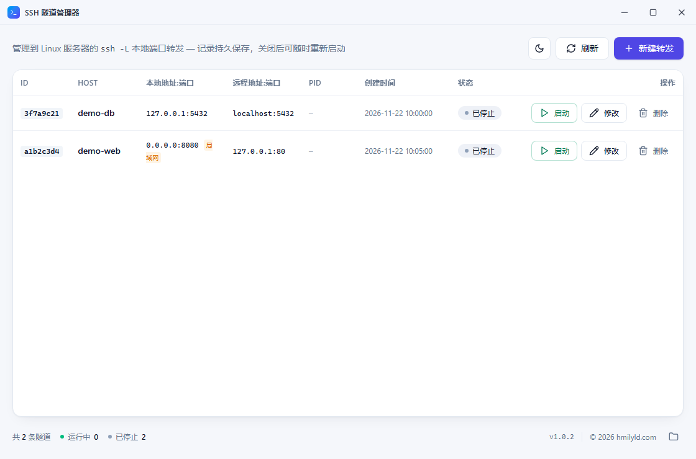
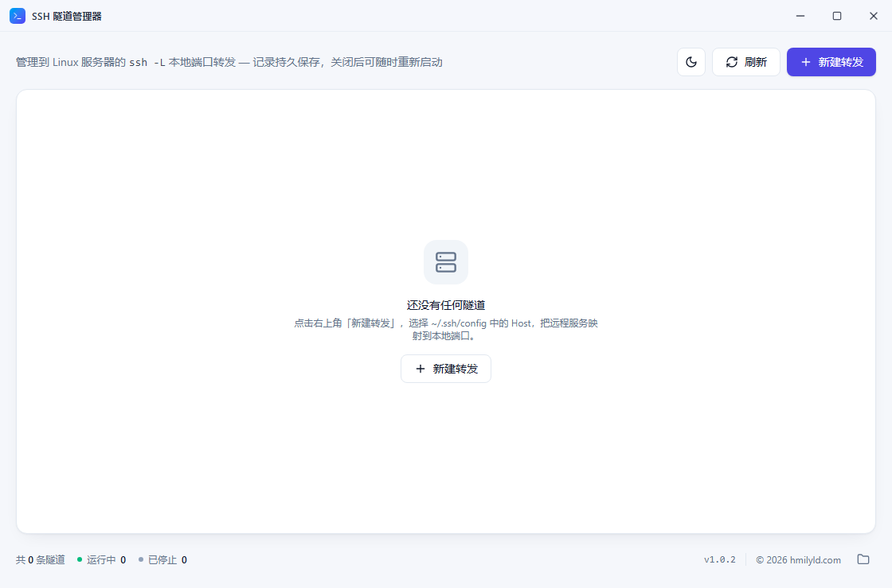

# SSH Tunnel Manager

[中文文档](README.md) · English

[](https://github.com/hmilyld/SSHTunnel/actions/workflows/ci.yml)
[](LICENSE)

A Tauri 2 desktop app for **Windows 10/11** and **macOS 12+** that manages
`ssh -L` local port forwards: create, inspect, stop, restart, edit and delete
forwards, with a system tray and JSON persistence.

- UI: React 19 + TypeScript (strict) + Tailwind CSS 4 + shadcn-style components
- Backend: Rust + Tauri 2
- SSH: the system `ssh` binary (`ssh -N -o ExitOnForwardFailure=yes ... -L ...`)
- Storage: `tunnels.json` in the platform application data directory
- Tray: Tauri tray API; closing the window hides it to the tray

> Copyright © 2026 [hmilyld.com](https://hmilyld.com) · MIT License

## Features

- Create local forwards from `~/.ssh/config` hosts.
- Success is reported only after the local `bind:port` is actually listening
  (not after a fixed delay); failures are classified into readable messages.
- Key and password authentication; passwords are passed only through
  `SSH_ASKPASS` child-process environment and are never written to disk/logs.
- Stopping a forward keeps its record (`pid = 0`, stopped); restart reuses it.
- Edit/delete only stopped records; deleting requires confirmation.
- Live state refresh every 3 s, immediate `tunnel-exited` event, and polling is
  paused while the window is hidden.
- System tray: show/hide window; quit while keeping or stopping all tunnels.
- Single-instance: a second launch focuses the existing window.
- Dark/light theme, persisted in `localStorage`.
- CSP enabled; CI runs formatting, lint, tests, coverage and dependency audits.

## Requirements

| Platform | Requirements |
| --- | --- |
| All | Rust 1.90+, Node.js 22.22+, pnpm 11+, OpenSSH client |
| Windows | Visual Studio 2022 (Desktop C++), WebView2 Runtime |
| macOS | Xcode Command Line Tools |

## Development

```bash
pnpm install
pnpm tauri dev
```

Verification:

```bash
pnpm format:check
pnpm lint
pnpm test
pnpm build

cargo fmt --manifest-path src-tauri/Cargo.toml --all -- --check
cargo clippy --manifest-path src-tauri/Cargo.toml --all-targets -- -D warnings
cargo test --manifest-path src-tauri/Cargo.toml
(cd src-tauri && cargo deny check)
(cd src-tauri && cargo audit)
```

## Screenshots

Rendered with demo data; no real hosts or credentials are shown.





## Project layout

```text
src/                 React frontend
src/lib/api.ts       typed Tauri command wrappers
src/lib/tunnelForm.ts  validated form helpers (pure functions)
src-tauri/src/       Rust backend
  commands.rs        Tauri command layer
  tunnel.rs          tunnel lifecycle
  ssh_start.rs       askpass, password probe, listening probe, spawn
  ssh_failure.rs     exit/stderr classification
  ssh_config.rs      ~/.ssh/config parser (Include, Host, ...)
  store.rs           tunnels.json persistence
  process.rs         cross-platform process detection/termination
  tray.rs            tray menu
  logging.rs         stdout + app.log (5 MB rotation)
  error.rs           user-facing errors
```

## Data

- Windows: `%APPDATA%\ssh-tunnel-manager\tunnels.json` and `app.log`
- macOS: `~/Library/Application Support/ssh-tunnel-manager/tunnels.json` and `app.log`

The JSON format is a list of records with `id`, `host`, `bind`, `local_port`,
`remote_host`, `remote_port`, `pid`, `created_at` (snake_case).

`~/.ssh/config` support: `Host`, `HostName`, `User`, `Port`, `IdentityFile`,
`Key=Value`, comments, and `Include` (relative to `~/.ssh`, `~`, glob; cycles
skipped, nesting limited to 16). Wildcard hosts and `Match` blocks are ignored.
Duplicate `Host` blocks follow OpenSSH's first-value-per-parameter rule.

## Release

Push a `vX.Y.Z` tag. GitHub Actions first runs the reusable quality gate
(format, lint, tests, coverage, audits, build, Rust checks), then builds:

- Windows: NSIS `*-setup.exe` and WiX `.msi`
- macOS: Apple Silicon and Intel `.dmg` files (unsigned)

Release asset file names use `SSHManager_<version>_<platform>_<arch>...`;
the installed app identity, `productName`, `identifier` and data directory are
unchanged. Update `version` in `package.json`, `src-tauri/tauri.conf.json` and
`src-tauri/Cargo.toml` before tagging.

## Security

Please report vulnerabilities through GitHub private advisories:
<https://github.com/hmilyld/SSHTunnel/security/advisories/new>
Do not open public issues for security problems. See [SECURITY.md](SECURITY.md).

## Contributing

See [CONTRIBUTING.md](CONTRIBUTING.md) and [CODE_OF_CONDUCT.md](CODE_OF_CONDUCT.md).
Use Conventional Commits and keep compatibility constraints documented in the
Chinese [README](README.md).

## License

[MIT](LICENSE) © 2026 hmilyld.com
