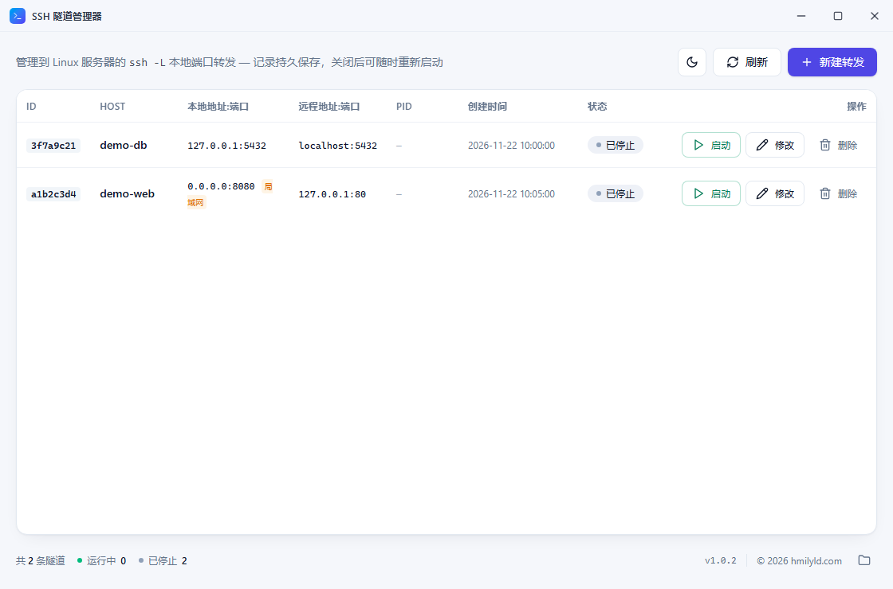
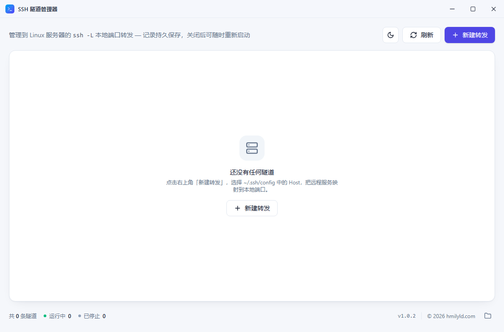

# SSH 隧道管理器

[English README](README.en.md)

[](https://github.com/hmilyld/SSHTunnel/actions/workflows/ci.yml)
[](LICENSE)

SSH 隧道管理器是一款面向 Windows 10/11 与 macOS 12+ 的桌面应用，用于管理到 Linux
服务器的 SSH 本地端口转发（`ssh -L`）。应用提供转发的新建、状态查看、关闭、重启、
修改与删除，并支持系统托盘、深/浅主题和 JSON 持久化。

技术栈：Tauri 2、Rust、React 19、TypeScript、Tailwind CSS 4、Vite。

## 功能

- 从 `~/.ssh/config` 选择 Host，支持 `Include`、密钥与密码认证。
- 以本地 `bind:port` 实际进入监听的时刻判定启动成功，并对 ssh 退出原因分类。
- 关闭转发保留记录；已停止记录可重新启动、修改或删除。
- 每 3 秒刷新状态；ssh 退出时通过事件即时更新；窗口隐藏时暂停轮询。
- 系统托盘、单实例、日志轮转和深/浅主题。
- CI 覆盖格式化、lint、测试、覆盖率、依赖审计与跨平台 Rust 检查。

## 界面

截图使用示例数据，不包含真实主机信息。





## 快速开始

### 环境

| 平台 | 依赖 |
| --- | --- |
| 通用 | Rust 1.90+、Node.js 22.22+、pnpm 11+、OpenSSH |
| Windows | Visual Studio 2022（使用 C++ 的桌面开发）、WebView2 Runtime |
| macOS | Xcode Command Line Tools |

### 开发

```bash
pnpm install
pnpm tauri dev
```

### 验证

```bash
pnpm format:check
pnpm lint
pnpm test
pnpm build

cargo fmt --manifest-path src-tauri/Cargo.toml --all -- --check
cargo clippy --manifest-path src-tauri/Cargo.toml --all-targets -- -D warnings
cargo test --manifest-path src-tauri/Cargo.toml
```

完整命令、覆盖率与依赖审计见 [开发文档](docs/development.md)。

### 打包

```bash
pnpm tauri build
```

Windows 产物位于 `src-tauri/target/release/bundle/{msi,nsis}/`，macOS 产物位于
`src-tauri/target/release/bundle/dmg/`。

## 文档

| 文档 | 内容 |
| --- | --- |
| [文档索引](docs/README.md) | 全部文档入口 |
| [架构](docs/architecture.md) | 技术栈、目录结构、模块边界、数据流、命令接口 |
| [配置与数据](docs/configuration.md) | 数据目录、`tunnels.json`、`~/.ssh/config`、认证 |
| [使用说明](docs/usage.md) | 转发操作、托盘、主题与密码认证 |
| [开发](docs/development.md) | 环境、命令、测试、覆盖率、CI、图标 |
| [发布](docs/release.md) | 版本号、tag、质量门禁、产物矩阵、资产命名 |
| [安全设计](docs/security.md) | 凭据处理、参数校验、进程校验、CSP、供应链 |
| [故障排查](docs/troubleshooting.md) | 常见问题、平台差异与已知限制 |
| [历史验证](docs/verification-history.md) | 构建、测试与实机验证记录 |

## 项目状态

当前版本为 `1.0.2`。本地验证包括前端 15 个测试、Rust 27 个测试、rustfmt、clippy、
cargo-deny、cargo-audit 与 release 二进制构建。前端与 Rust 覆盖率作为基线报告，
尚未设置硬阈值。

尚未完成的外部验证：GitHub Actions 首次实际运行、macOS 真机回归、安装包签名与公证。
详见 [故障排查](docs/troubleshooting.md)。

## 参与贡献

- [CONTRIBUTING.md](CONTRIBUTING.md)：开发环境、验证命令、提交与 PR 约定
- [SECURITY.md](SECURITY.md)：私密漏洞报告渠道
- [CODE_OF_CONDUCT.md](CODE_OF_CONDUCT.md)：Contributor Covenant 2.1
- [CHANGELOG.md](CHANGELOG.md)：版本变更记录

## 许可证

[MIT License](LICENSE) © 2026 [hmilyld.com](https://hmilyld.com)
