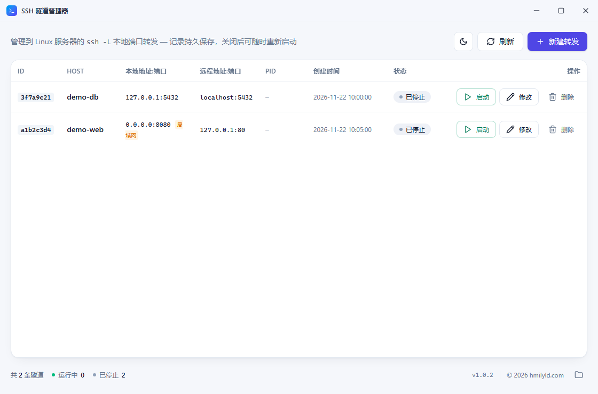
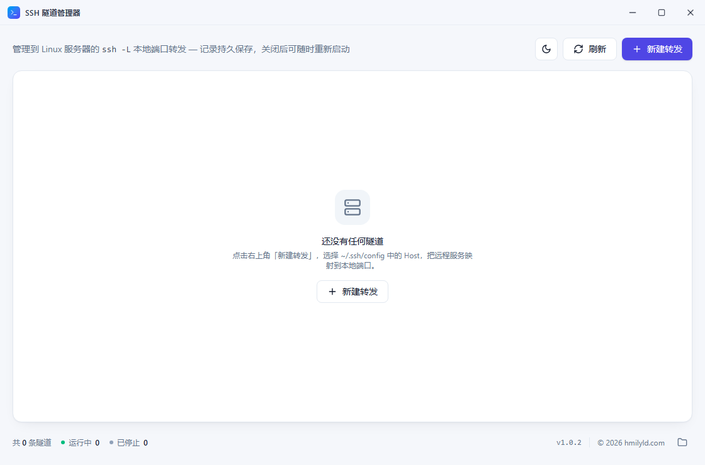

# 使用说明

## 界面

以下截图使用示例数据，不包含真实主机信息。

Windows 使用无边框窗口和自绘标题栏；macOS 使用系统原生标题栏。深色/浅色主题可
通过右上角按钮切换，并保存在 localStorage 中。

## 新建转发

1. 点击“新建转发”。
2. 选择 `~/.ssh/config` 中的 Host。
3. 填写远程主机、远程端口、本地端口和绑定地址。
   - 远程主机默认 `localhost`；
   - 本地端口默认跟随远程端口；
   - 远程主机为 `localhost` 或 `127.0.0.1` 时，绑定地址按同名规则联动；
   - 绑定 `0.0.0.0` 会把端口暴露到局域网，请确认网络环境。
4. 查看命令预览，点击“启动转发”。

命令预览可选中，也可通过右侧按钮复制。启动操作在本地 `bind:port` 真正进入监听后
才返回成功；失败时会显示后端归因后的错误。

## 查看状态

表格展示 ID、Host、本地地址、远程地址、PID、创建时间和状态。前端每 3 秒刷新一次，
也可手动刷新。ssh 进程中途退出时，后端会广播 `tunnel-exited`，界面立即转为“已停止”。
窗口隐藏时暂停轮询，恢复可见时立即刷新。

## 关闭、重启、修改、删除

- **关闭**：终止 ssh 进程，保留记录，PID 置 0。
- **启动**：复用已保存记录重新启动 ssh。
- **修改**：编辑已停止记录的 Host、绑定地址和端口；运行中的记录不可修改。
- **删除**：二次确认后删除已停止记录。

关闭不会删除记录。记录会长期保存在 `tunnels.json` 中，除非主动删除。

## 托盘与退出

关闭窗口仅隐藏到托盘，应用继续运行。左键托盘图标切换主窗口显示/隐藏；右键菜单提供：

- 显示主窗口；
- 退出应用（保留隧道）；
- 退出应用（关闭隧道）。

默认退出不终止 ssh 进程；选择“关闭隧道”会在退出前终止所有运行中的隧道。

## 单实例

第二次启动不会创建新的 GUI 进程，而是聚焦已有主窗口。这样可以避免两个进程同时写入
同一份 `tunnels.json`。

## 密码认证

服务器要求密码时，应用会弹出密码输入框。确认后先执行认证预检，密码错误会直接提示；
预检通过才建立隧道。密码仅通过子进程环境传递给 `ssh`，不会写入磁盘或日志。

认证与配置细节见 [configuration.md](configuration.md)。
